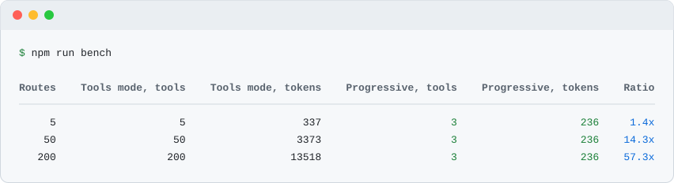

# fastify-mcp-routes

Your Fastify routes become MCP tools in one `register` call: no codegen, no OpenAPI file, and your hooks, auth and validation keep running because every tool call goes through `app.inject`. Read-only by default, with two modes: one tool per route, or three meta-tools that keep `tools/list` the same size at 5 routes and at 200. A Fastify take on the idea behind [fastapi_mcp](https://github.com/tadata-org/fastapi_mcp).



[](https://nodejs.org/)
[](https://fastify.dev/)
[](https://www.typescriptlang.org/)
[](https://github.com/kyoresuas/fastify-mcp-routes/actions/workflows/ci.yml)
[](LICENSE)

**English** · [Русский](README_RU.md)

[Quick start](#quick-start) · [Why](#why-fastify-mcp-routes) · [Modes](#modes) · [Options](#options) · [Security](#security) · [Limits](#what-it-does-not-do)

## Quick start

```bash
npm install fastify-mcp-routes
```

Register the plugin before the routes you want to expose:

```ts
import Fastify from "fastify";
import { mcpRoutes } from "fastify-mcp-routes";

const app = Fastify();

await app.register(mcpRoutes);

app.get(
  "/clients/:id",
  {
    schema: {
      summary: "Get a client by id",
      params: {
        type: "object",
        properties: { id: { type: "string" } },
        required: ["id"],
      },
      querystring: {
        type: "object",
        properties: { expand: { type: "boolean" } },
      },
    },
  },
  async (request) => ({ id: (request.params as { id: string }).id, name: "Alice" }),
);

await app.listen({ port: 3000 });
```

Connect Claude Code to the endpoint:

```bash
claude mcp add --transport http -s project app http://localhost:3000/mcp
```

`-s project` sets the scope: the server is written to `.mcp.json` in the project root, so everyone who clones the repository gets the same endpoint (Claude Code asks each person to approve it first). The default scope, `local`, keeps the server private to you in this project, and `user` makes it available in all your projects.

If the routes need credentials, pass them as headers. The plugin forwards `Authorization` and `x-api-key` to the route it calls. Use `-s local` or `-s user` here: with `-s project` the token would be written to `.mcp.json` and end up in git.

```bash
claude mcp add --transport http -s local app http://localhost:3000/mcp --header "Authorization: Bearer $TOKEN"
```

This is what an MCP client gets from `tools/list` for the app above (the output of a real request, formatted for reading):

```json
{
  "tools": [
    {
      "name": "get_clients_by_id",
      "description": "Get a client by id",
      "inputSchema": {
        "type": "object",
        "properties": {
          "id": { "type": "string" },
          "expand": { "type": "boolean" }
        },
        "required": ["id"]
      },
      "annotations": { "readOnlyHint": true }
    }
  ]
}
```

And the result of `tools/call` with `{ "id": "42" }`:

```json
{ "content": [{ "type": "text", "text": "{\"id\":\"42\",\"name\":\"Alice\"}" }] }
```

> [!IMPORTANT]
> Register `mcpRoutes` before the routes. The plugin collects routes with the `onRoute` hook, so routes registered earlier are not visible to it.

## Why fastify-mcp-routes?

| Capability | What it gives you |
| --- | --- |
| No codegen, no OpenAPI file | Tools are built from the routes Fastify already knows, through the `onRoute` hook |
| Your stack keeps running | Calls go through `app.inject`, so hooks, authorization and validation run as usual |
| Read-only by default | Only `GET` and `HEAD` are exposed. Mutations need `allow` or `readOnly: false` |
| Two modes | One tool per route, or three meta-tools whose `tools/list` does not grow with the route count |
| Stateless Streamable HTTP | `/mcp` lives in the same instance, with no sessions to store or expire |
| Measurable size | `app.mcpRoutes.stats()` estimates `tools/list` in tokens for both modes |
| Official SDK | Built on `@modelcontextprotocol/server` and `@modelcontextprotocol/node` 2.x, versions pinned |

## How it fits

```text
MCP client
                      │
        POST /mcp (Streamable HTTP, stateless)
                      │
              fastify-mcp-routes
                      │
     app.inject + Authorization and x-api-key
                      │
  Your routes: hooks · auth · validation · handlers
```

[amnezia-api](https://github.com/kyoresuas/amnezia-api) is a real Fastify 5 service with JSON-schema routes, the kind of application this plugin targets.

## Modes

Set the mode with the `mode` option.

| Mode | Tools in `tools/list` | Use it when |
| --- | --- | --- |
| `tools` (default) | One per exposed route | The app has a handful of routes and you want the model to see each one |
| `progressive` | Exactly three: `search_routes`, `describe_route`, `call_route` | The app has dozens of routes and `tools/list` should stay small |

In `progressive` mode the model searches first, then reads the schema of one route, then calls it. The same app as above, asked for `search_routes` with `{ "query": "client" }`, answers:

```json
{
  "matched": 1,
  "routes": [
    {
      "name": "get_clients_by_id",
      "method": "GET",
      "url": "/clients/:id",
      "description": "Get a client by id"
    }
  ]
}
```

`call_route` takes `{ "name": "get_clients_by_id", "arguments": { "id": "42" } }` and returns the same text as the tool in `tools` mode.

### How big is tools/list

The size is estimated as the characters of `JSON.stringify(tools)` divided by 4, rounded up. This is a rough rule, not a tokenizer. `npm run bench` builds fixtures with 5, 50 and 200 routes (per resource: list, get, create, update, delete, each with summaries and typed params, query and body) with `readOnly: false` and prints this table:

| Routes | Tools mode, tools | Tools mode, tokens | Progressive, tools | Progressive, tokens | Ratio |
| ---: | ---: | ---: | ---: | ---: | ---: |
| 5 | 5 | 337 | 3 | 236 | 1.4x |
| 50 | 50 | 3373 | 3 | 236 | 14.3x |
| 200 | 200 | 13518 | 3 | 236 | 57.3x |

The `progressive` size is the same for every app, because it depends only on the three fixed tool definitions. The `tools` size grows linearly with the route count.

For your own app, call `app.mcpRoutes.stats()` after `app.ready()`. For the Quick start app it returns:

```json
{
  "method": "chars/4",
  "routes": { "total": 1, "exposed": 1, "hidden": 0 },
  "modes": {
    "tools": { "tools": 1, "chars": 217, "tokens": 55 },
    "progressive": { "tools": 3, "chars": 941, "tokens": 236 }
  }
}
```

`app.mcpRoutes.routes()` lists the exposed routes with their tool names.

## Tool names and input

The name of a tool is the first of these that exists:

1. `config.mcp.name` of the route.
2. `schema.operationId` of the route, or the `operationId` from `@fastify/swagger`.
3. The method and the URL: `GET /clients/:id/orders` becomes `get_clients_by_id_orders`.

Names use letters, digits, `_`, `.` and `-`, are cut at 64 characters, and get a suffix `_2`, `_3` when they repeat.

The description is the first of `config.mcp.description`, `schema.description`, `schema.summary`, the same fields from `@fastify/swagger`, or `METHOD /url`.

`inputSchema` merges `params`, `querystring` and `body` into one flat object:

- A path parameter that has no schema becomes a required string. `:id?` is optional, and when it is left out the route receives an empty string. A `*` wildcard becomes the argument `wildcard`.
- If a name repeats, the later source gets a prefix: `query_id`, `body_id`.
- A body that is not an object with properties (an array, for example) becomes the argument `body`. `POST`, `PUT` and `PATCH` routes without a body schema get an optional `body` object.
- `$ref` to schemas added with `app.addSchema` is inlined.
- Arguments that are not in the schema are ignored.

What a tool call returns:

| The route answers | The tool result |
| --- | --- |
| 2xx or 3xx with a body | The body as text, unchanged |
| 2xx or 3xx with an empty body | `{"status":204}`. For `HEAD` and 3xx, `headers` are added, without `date` and `connection` because they change on every call |
| 4xx or 5xx | `isError: true` and the text `{"status":404,"body":{...}}` |
| A path parameter is missing, or the tool is unknown | `isError: true` and a short message |

## Security

- **Read-only by default.** Only `GET` and `HEAD` become tools. Open a mutation with `allow: ["POST /clients"]` or open everything with `readOnly: false`.
- **Closing wins.** `deny`, `config.mcp.hidden: true` and `schema.hide: true` beat `allow`. `OPTIONS` is never exposed, and neither is the `/mcp` endpoint itself.
- **Your authorization applies.** The plugin copies `Authorization` and `x-api-key` from the MCP request to the route call. Without them a protected route answers 401 and the tool returns `isError`. Change the list with `forwardHeaders`.
- **Browsers are refused by default.** A request with an `Origin` header gets 403 unless its hostname is in `allowedOrigins`. Non-browser MCP clients normally send no `Origin`.
- **The endpoint itself is not authenticated.** `tools/list` shows route names and schemas to anyone who can reach `/mcp`. Hide internal routes, bind to a private network, or register the plugin inside a scope that has your own auth hook:

```ts
await app.register(
  async (scope) => {
    scope.addHook("onRequest", requireAuth);
    await scope.register(mcpRoutes);
    scope.get("/reports", reportsHandler);
  },
  { prefix: "/api" },
);
```

Here the endpoint is `/api/mcp`, the hook protects it, and only the routes of this scope become tools.

## Options

| Option | Default | Description |
| --- | --- | --- |
| `endpoint` | `"/mcp"` | Path of the endpoint, relative to the prefix the plugin is registered with |
| `mode` | `"tools"` | `"tools"` or `"progressive"` |
| `readOnly` | `true` | Expose only `GET` and `HEAD` |
| `allow` | `[]` | Rules that open a route even when `readOnly` is `true` |
| `deny` | `[]` | Rules that close a route. They win over `allow` |
| `forwardHeaders` | `["authorization", "x-api-key"]` | Headers of the MCP request copied to the route call |
| `allowedOrigins` | `[]` | Hostnames accepted in the `Origin` header, without scheme and port |
| `swagger` | `true` | Fill missing descriptions and `operationId` from `@fastify/swagger` when it is registered |
| `serverInfo` | package name and version | `{ name, version }` returned by `initialize` |
| `instructions` | none | Text for the model returned by `initialize` |

A rule is `"METHOD /url"`, for example `"POST /clients"`, `"DELETE /clients/:id"` or `"* /admin/*"`. Without a method it matches every method. `*` matches any characters. The URL is compared with the registered pattern, including the prefix, so write `/clients/:id`, not `/clients/42`.

Per-route settings go to `config.mcp`:

```ts
app.get(
  "/internal/stats",
  { config: { mcp: { name: "service_stats", description: "Current service counters" } } },
  statsHandler,
);

app.get("/internal/debug", { config: { mcp: { hidden: true } } }, debugHandler);
```

## @fastify/swagger

If `@fastify/swagger` is registered, the plugin reads the OpenAPI document after the app is ready and uses its `summary`, `description` and `operationId` for routes that do not have them in their own schema. This matters when a `transform` function or another plugin fills the documentation. Set `swagger: false` to turn it off. The package is an optional peer dependency.

## What it does not do

- **Zod-style schemas.** Route schemas must be JSON Schema (plain objects, TypeBox included). Schemas that are class instances, such as those from Zod type providers, are skipped, and the tool then lacks those arguments.
- **Only tools.** No resources, prompts, sessions, resumable streams or server-initiated notifications. `GET` and `DELETE` on `/mcp` answer 405. The one exception is `DELETE` with `Content-Type: application/json` and an empty body: Fastify's body parser rejects it before the plugin runs, so the answer is 400 with `FST_ERR_CTP_EMPTY_JSON_BODY`. Send the `DELETE` without that header, or with a body, to get the 405.
- **Text results.** Binary and streamed responses are returned as text.
- **Registration order.** Routes registered before the plugin are not seen.
- **Token estimates are approximate.** The `chars/4` rule is not a tokenizer.
- **Large apps.** In `tools` mode `tools/list` grows with the route count. Use `progressive` mode or `deny`.
- **ESM only.** The package requires Node.js 22.12 or newer. `require()` works on those versions.

## Development

```bash
npm ci
npm run lint
npm test
npm run build
npm run bench
```

Node.js 22.12 and newer. CI runs lint, tests, build and bench on Node.js 22 and 24. The tests start a real server with `app.listen({ port: 0 })` and talk to it with the official MCP client over Streamable HTTP. Architecture notes are in [AGENTS.md](AGENTS.md), contribution rules in [CONTRIBUTING.md](CONTRIBUTING.md).

## Support the project

If fastify-mcp-routes is useful to you, you can support its development:

- **TON:** `kyoresuas.ton`
- **TON wallet address:** `UQATzyMcVoZudjaA5Rc9w5TV_lIqxh9DPk0gSnjkLVvwEVqz`
- **USDT on TRON (TRC-20):** `TJSLjDo4yRgHr9JqqEcrkbC51bP9DCiBC7`

Please verify the network before transferring cryptocurrency.

## Contact

- [GitHub Issues](https://github.com/kyoresuas/fastify-mcp-routes/issues)
- Telegram: [@stercuss](https://t.me/stercuss)
- Email: [hey@kyoresuas.com](mailto:hey@kyoresuas.com)

## Disclaimer

An independent project. Not affiliated with Anthropic, the Model Context Protocol project or Fastify, not sponsored, no advertising of AI services.

## License

[MIT](LICENSE)
