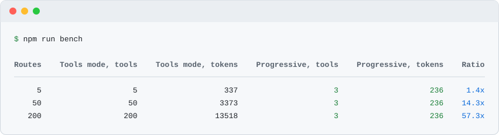

# fastify-mcp-routes

Маршруты Fastify становятся инструментами MCP одним вызовом `register`: без кодогенерации и OpenAPI-файла, а хуки, авторизация и валидация продолжают работать, потому что каждый вызов инструмента идёт через `app.inject`. По умолчанию только чтение, два режима: инструмент на маршрут или три мета-инструмента, при которых `tools/list` одного размера и на 5 маршрутах, и на 200. Версия идеи [fastapi_mcp](https://github.com/tadata-org/fastapi_mcp) для Fastify.



[](https://nodejs.org/)
[](https://fastify.dev/)
[](https://www.typescriptlang.org/)
[](https://github.com/kyoresuas/fastify-mcp-routes/actions/workflows/ci.yml)
[](LICENSE)

[English](README.md) · **Русский**

[Быстрый старт](#быстрый-старт) · [Зачем](#зачем-это-нужно) · [Режимы](#режимы) · [Опции](#опции) · [Безопасность](#безопасность) · [Пределы](#чего-плагин-не-делает)

## Быстрый старт

```bash
npm install fastify-mcp-routes
```

Зарегистрируйте плагин до маршрутов, которые нужно открыть:

```ts
import Fastify from "fastify";
import { mcpRoutes } from "fastify-mcp-routes";

const app = Fastify();

await app.register(mcpRoutes);

app.get(
  "/clients/:id",
  {
    schema: {
      summary: "Get a client by id",
      params: {
        type: "object",
        properties: { id: { type: "string" } },
        required: ["id"],
      },
      querystring: {
        type: "object",
        properties: { expand: { type: "boolean" } },
      },
    },
  },
  async (request) => ({ id: (request.params as { id: string }).id, name: "Alice" }),
);

await app.listen({ port: 3000 });
```

Подключите Claude Code к эндпоинту:

```bash
claude mcp add --transport http -s project app http://localhost:3000/mcp
```

`-s project` задаёт область (scope): сервер записывается в `.mcp.json` в корне проекта, поэтому каждый, кто клонирует репозиторий, получает тот же эндпоинт (Claude Code сначала спросит у него подтверждение). Область по умолчанию, `local`, оставляет сервер только вам и только в этом проекте, а `user` делает его доступным во всех ваших проектах.

Если маршрутам нужны учётные данные, передайте их заголовками. Плагин пробрасывает `Authorization` и `x-api-key` в вызываемый маршрут. Здесь берите `-s local` или `-s user`: при `-s project` токен попадёт в `.mcp.json` и дальше в git.

```bash
claude mcp add --transport http -s local app http://localhost:3000/mcp --header "Authorization: Bearer $TOKEN"
```

Так выглядит ответ `tools/list` для приложения выше (вывод настоящего запроса, отформатированный для чтения):

```json
{
  "tools": [
    {
      "name": "get_clients_by_id",
      "description": "Get a client by id",
      "inputSchema": {
        "type": "object",
        "properties": {
          "id": { "type": "string" },
          "expand": { "type": "boolean" }
        },
        "required": ["id"]
      },
      "annotations": { "readOnlyHint": true }
    }
  ]
}
```

И результат `tools/call` с аргументами `{ "id": "42" }`:

```json
{ "content": [{ "type": "text", "text": "{\"id\":\"42\",\"name\":\"Alice\"}" }] }
```

> [!IMPORTANT]
> Регистрируйте `mcpRoutes` до маршрутов. Плагин собирает маршруты хуком `onRoute`, поэтому маршруты, зарегистрированные раньше, он не видит.

## Зачем это нужно

| Возможность | Что даёт |
| --- | --- |
| Без кодогенерации и OpenAPI-файла | Инструменты строятся из маршрутов, которые Fastify уже знает, через хук `onRoute` |
| Ваш стек продолжает работать | Вызовы идут через `app.inject`, поэтому хуки, авторизация и валидация работают как обычно |
| По умолчанию только чтение | Наружу идут только `GET` и `HEAD`. Мутации открываются через `allow` или `readOnly: false` |
| Два режима | Инструмент на маршрут или три мета-инструмента, при которых `tools/list` не растёт с числом маршрутов |
| Stateless Streamable HTTP | `/mcp` живёт в том же инстансе, сессий для хранения и протухания нет |
| Размер можно измерить | `app.mcpRoutes.stats()` оценивает `tools/list` в токенах для обоих режимов |
| Официальный SDK | Построен на `@modelcontextprotocol/server` и `@modelcontextprotocol/node` 2.x, версии закреплены |

## Как это работает

```text
MCP-клиент
                      │
        POST /mcp (Streamable HTTP, stateless)
                      │
              fastify-mcp-routes
                      │
     app.inject + Authorization и x-api-key
                      │
  Ваши маршруты: хуки · авторизация · валидация · обработчики
```

[amnezia-api](https://github.com/kyoresuas/amnezia-api) это настоящий сервис на Fastify 5 с маршрутами на JSON Schema, то есть приложение того вида, под который сделан плагин.

## Режимы

Режим задаётся опцией `mode`.

| Режим | Инструментов в `tools/list` | Когда брать |
| --- | --- | --- |
| `tools` (по умолчанию) | По одному на открытый маршрут | В приложении несколько маршрутов, и модель должна видеть каждый |
| `progressive` | Ровно три: `search_routes`, `describe_route`, `call_route` | В приложении десятки маршрутов, и `tools/list` должен оставаться маленьким |

В режиме `progressive` модель сначала ищет, потом читает схему одного маршрута, потом вызывает его. Для того же приложения `search_routes` с аргументами `{ "query": "client" }` отвечает:

```json
{
  "matched": 1,
  "routes": [
    {
      "name": "get_clients_by_id",
      "method": "GET",
      "url": "/clients/:id",
      "description": "Get a client by id"
    }
  ]
}
```

`call_route` принимает `{ "name": "get_clients_by_id", "arguments": { "id": "42" } }` и возвращает тот же текст, что инструмент в режиме `tools`.

### Насколько велик tools/list

Размер оценивается как число символов в `JSON.stringify(tools)`, делённое на 4 и округлённое вверх. Это грубое правило, а не токенайзер. `npm run bench` строит фикстуры на 5, 50 и 200 маршрутов (на ресурс: list, get, create, update, delete, у каждого summary и типизированные params, query и body) с `readOnly: false` и печатает таблицу:

| Routes | Tools mode, tools | Tools mode, tokens | Progressive, tools | Progressive, tokens | Ratio |
| ---: | ---: | ---: | ---: | ---: | ---: |
| 5 | 5 | 337 | 3 | 236 | 1.4x |
| 50 | 50 | 3373 | 3 | 236 | 14.3x |
| 200 | 200 | 13518 | 3 | 236 | 57.3x |

Размер `progressive` одинаков для любого приложения, потому что зависит только от трёх фиксированных определений. Размер `tools` растёт линейно с числом маршрутов.

Для своего приложения вызовите `app.mcpRoutes.stats()` после `app.ready()`. Для приложения из быстрого старта вернётся:

```json
{
  "method": "chars/4",
  "routes": { "total": 1, "exposed": 1, "hidden": 0 },
  "modes": {
    "tools": { "tools": 1, "chars": 217, "tokens": 55 },
    "progressive": { "tools": 3, "chars": 941, "tokens": 236 }
  }
}
```

`app.mcpRoutes.routes()` возвращает открытые маршруты с именами инструментов.

## Имена инструментов и входные данные

Имя инструмента это первое из существующего:

1. `config.mcp.name` маршрута.
2. `schema.operationId` маршрута или `operationId` из `@fastify/swagger`.
3. Метод и URL: `GET /clients/:id/orders` превращается в `get_clients_by_id_orders`.

В имени допустимы буквы, цифры, `_`, `.` и `-`, длина обрезается до 64 символов, повторы получают суффикс `_2`, `_3`.

Описание это первое из `config.mcp.description`, `schema.description`, `schema.summary`, тех же полей из `@fastify/swagger` или `METHOD /url`.

`inputSchema` объединяет `params`, `querystring` и `body` в один плоский объект:

- Параметр пути без схемы становится обязательной строкой. `:id?` необязателен, а если его не передать, маршрут получит пустую строку. Wildcard `*` становится аргументом `wildcard`.
- Если имя повторяется, поздний источник получает префикс: `query_id`, `body_id`.
- Тело, которое не объект со свойствами (например, массив), становится аргументом `body`. У маршрутов `POST`, `PUT` и `PATCH` без схемы тела появляется необязательный объект `body`.
- `$ref` на схемы, добавленные через `app.addSchema`, раскрывается.
- Аргументы, которых нет в схеме, игнорируются.

Что возвращает вызов инструмента:

| Маршрут ответил | Результат инструмента |
| --- | --- |
| 2xx или 3xx с телом | Тело текстом, без изменений |
| 2xx или 3xx с пустым телом | `{"status":204}`. Для `HEAD` и 3xx добавляются `headers` без `date` и `connection`, потому что они меняются при каждом вызове |
| 4xx или 5xx | `isError: true` и текст `{"status":404,"body":{...}}` |
| Нет параметра пути или инструмент неизвестен | `isError: true` и короткое сообщение |

## Безопасность

- **По умолчанию только чтение.** Инструментами становятся только `GET` и `HEAD`. Мутацию открывает `allow: ["POST /clients"]`, всё сразу открывает `readOnly: false`.
- **Закрытие сильнее открытия.** `deny`, `config.mcp.hidden: true` и `schema.hide: true` сильнее `allow`. `OPTIONS` не открывается никогда, как и сам эндпоинт `/mcp`.
- **Работает ваша авторизация.** Плагин копирует `Authorization` и `x-api-key` из MCP-запроса в вызов маршрута. Без них защищённый маршрут отвечает 401, а инструмент возвращает `isError`. Список меняется опцией `forwardHeaders`.
- **Браузеры по умолчанию отклоняются.** Запрос с заголовком `Origin` получает 403, пока имя хоста не указано в `allowedOrigins`. Небраузерные MCP-клиенты обычно `Origin` не отправляют.
- **Сам эндпоинт не аутентифицируется.** `tools/list` показывает имена маршрутов и схемы любому, кто достучался до `/mcp`. Скройте внутренние маршруты, держите сервис в закрытой сети или зарегистрируйте плагин внутри области с вашим хуком авторизации:

```ts
await app.register(
  async (scope) => {
    scope.addHook("onRequest", requireAuth);
    await scope.register(mcpRoutes);
    scope.get("/reports", reportsHandler);
  },
  { prefix: "/api" },
);
```

Здесь эндпоинт получает путь `/api/mcp`, хук его защищает, а инструментами становятся только маршруты этой области.

## Опции

| Опция | По умолчанию | Описание |
| --- | --- | --- |
| `endpoint` | `"/mcp"` | Путь эндпоинта относительно префикса, с которым зарегистрирован плагин |
| `mode` | `"tools"` | `"tools"` или `"progressive"` |
| `readOnly` | `true` | Открывать только `GET` и `HEAD` |
| `allow` | `[]` | Правила, открывающие маршрут даже при `readOnly: true` |
| `deny` | `[]` | Правила, закрывающие маршрут. Сильнее `allow` |
| `forwardHeaders` | `["authorization", "x-api-key"]` | Заголовки MCP-запроса, которые копируются в вызов маршрута |
| `allowedOrigins` | `[]` | Имена хостов, допустимые в заголовке `Origin`, без схемы и порта |
| `swagger` | `true` | Дополнять описания и `operationId` из `@fastify/swagger`, если он зарегистрирован |
| `serverInfo` | имя и версия пакета | `{ name, version }` в ответе `initialize` |
| `instructions` | нет | Текст для модели в ответе `initialize` |

Правило выглядит как `"METHOD /url"`, например `"POST /clients"`, `"DELETE /clients/:id"` или `"* /admin/*"`. Без метода правило подходит любому методу. `*` заменяет любые символы. URL сравнивается с зарегистрированным шаблоном вместе с префиксом, поэтому пишите `/clients/:id`, а не `/clients/42`.

Настройки отдельного маршрута задаются в `config.mcp`:

```ts
app.get(
  "/internal/stats",
  { config: { mcp: { name: "service_stats", description: "Current service counters" } } },
  statsHandler,
);

app.get("/internal/debug", { config: { mcp: { hidden: true } } }, debugHandler);
```

## @fastify/swagger

Если зарегистрирован `@fastify/swagger`, плагин читает документ OpenAPI после готовности приложения и берёт из него `summary`, `description` и `operationId` для маршрутов, у которых их нет в собственной схеме. Это важно, когда документацию дополняет функция `transform` или другой плагин. Опция `swagger: false` отключает чтение. Пакет является необязательной peer-зависимостью.

## Чего плагин не делает

- **Схемы в стиле Zod.** Схемы маршрутов должны быть JSON Schema (обычные объекты, TypeBox подходит). Схемы, которые являются экземплярами классов, например из Zod type providers, пропускаются, и у инструмента не будет этих аргументов.
- **Только инструменты.** Нет ресурсов, промптов, сессий, возобновляемых потоков и уведомлений от сервера. `GET` и `DELETE` на `/mcp` отвечают 405. Исключение: `DELETE` с `Content-Type: application/json` и пустым телом. Парсер тела Fastify отклоняет его раньше плагина, поэтому ответ 400 с `FST_ERR_CTP_EMPTY_JSON_BODY`. Отправьте `DELETE` без этого заголовка или с телом, и придёт 405.
- **Результат текстом.** Бинарные и потоковые ответы возвращаются как текст.
- **Порядок регистрации.** Маршруты, зарегистрированные до плагина, не видны.
- **Оценка токенов приблизительная.** Правило `chars/4` не заменяет токенайзер.
- **Большие приложения.** В режиме `tools` размер `tools/list` растёт с числом маршрутов. Используйте режим `progressive` или `deny`.
- **Только ESM.** Пакету нужен Node.js 22.12 и новее. На этих версиях работает и `require()`.

## Разработка

```bash
npm ci
npm run lint
npm test
npm run build
npm run bench
```

Node.js 22.12 и новее. CI прогоняет lint, тесты, сборку и bench на Node.js 22 и 24. Тесты поднимают настоящий сервер через `app.listen({ port: 0 })` и обращаются к нему официальным MCP-клиентом по Streamable HTTP. Описание архитектуры в [AGENTS.md](AGENTS.md), правила для вкладчиков в [CONTRIBUTING.md](CONTRIBUTING.md).

## Поддержать проект

Если проект оказался полезен, вы можете поддержать его развитие:

- **TON:** `kyoresuas.ton`
- **Адрес кошелька TON:** `UQATzyMcVoZudjaA5Rc9w5TV_lIqxh9DPk0gSnjkLVvwEVqz`
- **USDT в сети TRON (TRC-20):** `TJSLjDo4yRgHr9JqqEcrkbC51bP9DCiBC7`

Перед переводом криптовалюты убедитесь, что выбрана правильная сеть.

## Связаться

- [GitHub Issues](https://github.com/kyoresuas/fastify-mcp-routes/issues)
- Telegram: [@stercuss](https://t.me/stercuss)
- Email: [hey@kyoresuas.com](mailto:hey@kyoresuas.com)

## Дисклеймер

Независимый проект. Не связан с Anthropic, проектом Model Context Protocol и Fastify, не спонсируется и не рекламирует ИИ-сервисы.

## Лицензия

[MIT](LICENSE)
